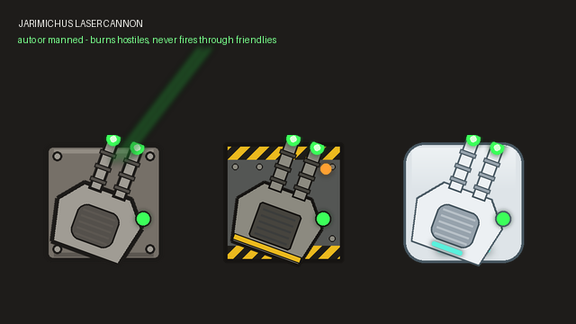

# Jarimichus Lasers

Power your colony with light. Jarimichus Lasers brings high-tech laser technology to RimWorld 1.4, 1.5 and 1.6: wireless power beamed across the map, a laser that mines rock for you, a laser cannon that burns raiders, and a fire-control console to crew them.

The mod comes in five parts. Use them together, or switch off the ones you don't want in the mod settings.

| Part | In short |
|---|---|
| **Beamwire** | Wireless power. Fire electricity from one grid to another as a laser beam, bent by mirrors and split by prisms. |
| **Mining laser** | A three-barrelled turret that cuts marked rock and ore for full yield. |
| **Laser cannon** | A twin-barrelled defence turret that locks two burning red beams onto hostiles. |
| **Laser control console** | A cockpit-style station where one colonist mans up to three lasers. |
| **Laser fences** | Posts that link up in lines and fill the gaps with a curtain of laser light that only your people can pass. |

Beamwire beams can power the lasers too: they use beam power first, and their own grid tops them up.

---

## Beamwire: wireless power

Build a **beam emitter** on one power grid and a **beam receiver** on another, and power flows between them through the air. No conduits, no wires across the map.

- **Nine buildings:** emitter, receiver, mirror, splitter, prism, relay, safety shutter, beam capacitor and beam window.
- **It aims itself.** Auto-aim turns emitters, mirrors, splitters and relays so beams reach every receiver they can, and re-aims as you build. Rotate any node by hand to take control.
- **Eight directions.** Beams travel straight and diagonally. Mirrors turn them 90°, splitters and prisms divide them by demand, and relays carry them across the map at full range.
- **Only draws what's needed.** Emitters send just what the receivers want. A little power is lost at each bounce and over distance.
- **Dangerous.** Powered beams burn anyone standing in them. Safety shutters close automatically while a colonist is in the beam.
- **Upkeep.** Optics gather dust and need cleaning, explosions can knock nodes out of alignment, and emitters and receivers can break down.
- **Store it.** Beam capacitors bank spare power and cover shortfalls.
- **Through walls.** Beam windows seal a room but let beams pass.

| Building | What it does |
|---|---|
| Emitter | Draws from its grid and fires a beam, up to its throughput limit (250 W to 4 kW). |
| Receiver | Catches beams from any side and feeds its grid. |
| Mirror | Turns a beam 90°, or bounces it straight back head-on. |
| Splitter | Every beam both passes through and turns 90°, with power shared by demand. |
| Prism | Every beam goes straight on and turns to both sides. |
| Relay | Re-fires incoming beams as one, at full range. Uses 30 W. |
| Safety shutter | A lossless gate that closes while a colonist is in the beam beyond it. |
| Beam capacitor | Stores 600 Wd, charges from spare power and covers shortfalls. |
| Beam window | A wall that beams pass through. It joins up with walls and other windows, so a row of them forms one long pane, in either direction. |

**Research.** Beamwire has its own research tab, tied into vanilla progression:

| Project | Unlocks | Needs |
|---|---|---|
| Beam optics | Emitter, receiver, mirror, beam window | Electricity, Solar panels |
| Beam safety | Safety shutter | Beam optics, Autodoors |
| Beam splitting | Splitter, prism | Beam optics, Microelectronics (hi-tech bench) |
| Coherent relays | Relay | Beam splitting, Fabrication (hi-tech bench) |
| Beam capacitors | Beam capacitor | Coherent relays, Batteries (hi-tech bench) |

---

## Mining laser

Mark rock for mining and let the laser do the rest.

- Cuts the nearest rock or ore **marked for mining** that it can see in a straight line, at any angle, within **30 tiles**.
- Leaves the **same yield** a colonist would.
- About **50 HP per second** at its full 1,500 W, roughly a good miner: granite in about 18 seconds, steel ore in about 30. Less power, slower cutting.
- Draws power only while it has work (20 W idle).
- Three orange cutting beams that pulse independently. Its beam burns anyone who walks through it.
- **Cost:** 200 steel, 25 plasteel, 5 components. **Research:** Mining laser (Electricity + Deep drilling).

---

## Laser cannon

A defence turret that never misses.

- Locks two continuous red beams onto the nearest hostile it can see within **28 tiles**.
- **18 DPS** on its own, **27 DPS** when manned, between the vanilla mini-turret and autocannon. Each pulse has a chance to set the target alight.
- **Holds fire** while a colonist, ally, guest, prisoner or tame animal is in the line of fire.
- **Man it** for +6 range and ×1.5 damage. Force target, clear target and hold fire controls included.
- Uses up to 1,000 W only while it has a target (50 W idle). Damage scales with the power it gets.
- **Cost:** 200 steel, 40 plasteel, 5 components. **Research:** Laser cannon (Gun turrets + Microelectronics, hi-tech bench).

---

## Laser control console

Crew your turrets from somewhere safe.

- **Link up to three** laser cannons or mining lasers within 20 tiles.
- One colonist at the console mans them all. Cannons gain range and damage; mining lasers cut ×1.5 faster and let you **choose which rock** to cut next.
- A cockpit-style station: radar scope, two status screens, throttle, guarded fire button, arming switches and a flight stick.
- Ideal for crewing hull-mounted turrets from inside a gravship.
- **Cost:** 80 steel, 3 components, 100 W. **Research:** Microelectronics.

---

## Laser fences

Seal a gateway with light.

- Build **laser fence posts** in a line. Each post links with the nearest post in line to the north, east, south and west, across up to **5 tiles**, and fills the gap with a red laser curtain. Build a row for a fence, corners and all, or a pair across a doorway for a gate.
- **Tuck the posts away** with Beamwire: a fence bends off **mirrors** (up to 4, each leg up to 5 tiles) and passes through **beam windows**, so the posts can sit inside your walls with only mirrors or windows in the wall line. Rotate those mirrors by hand so auto-aim leaves them alone.
- **Barrier mode:** the curtain blocks the way like a locked door. Colonists and allies walk through; hostiles have to break through, and whatever hits the curtain lands on the nearest post (300 HP) or mirror of that stretch.
- **Burn mode:** anyone can walk through, but hostiles in the curtain are burned every second. Each mirror on the way costs 5% of the burn. It switches off while a colonist, guest or tame animal is in it.
- **Power setting:** 150, 300, 600 or 1,200 W per post, for 12, 17, 24 or 34 burn per second.
- One button switches the whole connected fence between modes, another sets its power. While placing a post, the straight gaps it would close are outlined.
- No power, no fence.
- **Cost:** 50 steel, 15 plasteel, 2 components per post. **Research:** Laser fences (Autodoors + Microelectronics).

---

## Odyssey

Odyssey is optional. With it:

- Lasers and the console built on a **gravship's** deck switch to a flush, hull-mounted look that blends into the ship.
- **In vacuum,** the mining laser cuts ×1.5 faster, the laser cannon does ×1.5 damage, and both reach a quarter further.
- Beamwire optics in vacuum **never gather dust**.

---

## Mod settings

- **Parts:** switch Beamwire, the mining laser, the laser cannon or the laser fences off. Their buildings and research disappear after a restart. The console stays while either laser is on.
- **Beamwire:** auto-aim, beam burns, power losses, range, weather, roofs, dust and beam visibility.
- **Mining laser:** whether its cutting beam burns, and how hard.
- **Laser cannon:** damage, and whether it attacks hostile animals.

---

## Compatibility

- **Vanilla Expanded power mods:** works out of the box. Emitters and receivers are ordinary power-grid buildings, so VE batteries, generators and conduits work with them.
- **Combat Extended:** a patch gives the beam nodes a carry bulk, and beam burns are heat damage. Not yet tested in game under CE.
- **Other mods' buildings** can be powered by Beamwire beams through a small API (see [For modders](#for-modders)).

Requires [Harmony](https://steamcommunity.com/workshop/filedetails/?id=2009463077).

---

## Credits

- **Jarimichu:** idea, design and direction.
- Beam rendering technique inspired by Mlie's MIT-licensed [MiningCo. DrillTurret](https://github.com/emipa606/MiningCoDrillTurret). No code or assets are copied from it.

**Found a bug or have an idea?** [Open an issue](https://github.com/Jarimichu/Beamwire/issues).

---

## For modders

### Beam-powered devices API

Let Beamwire beams power your own buildings, with no compile-time reference either way. The mod's own lasers use this (see `Common/Patches/LaserBeamPower.xml`).

1. Give one of your building's comps these public members (found by name):
   - `float BeamWantedWatts { get; }`: watts wanted from beams right now (0 means nothing to do).
   - `void SetBeamWatts(float watts)`: called after every solve with the watts the beams deliver.
   - optional `IEnumerable<IntVec3> BeamGuardLine { get; }`: the cells your device fires along, so safety shutters on that line guard the stretch beyond them.
2. Ship a patch that loads only when Jarimichus Lasers is active (in `LoadFolders.xml`: `<li IfModActive="jarimichu.lasers">Mods/JarimichusLasers</li>`) and adds two comps to your building:

```xml
<Operation Class="PatchOperationAdd">
  <xpath>Defs/ThingDef[defName="YourBuilding"]/comps</xpath>
  <value>
    <li Class="Beamwire.CompProperties_BeamNode">
      <kind>Receiver</kind>
      <rotatable>false</rotatable>
    </li>
    <li Class="Beamwire.CompProperties_BeamPowered" />
  </value>
</Operation>
```

Auto-aim then routes beams to your building whenever it wants power. To respect Beamwire from your side, a closed safety shutter has a comp whose `bool BlocksLasers` is true, and beam windows' defs carry the mod extension `Beamwire.BeamTransparentExtension`.

### Building from source

You need the .NET 8 SDK. No RimWorld install is needed, because the build uses the `Krafs.Rimworld.Ref` reference assemblies.

```bash
dotnet test Source/JarimichusLasers.Tests
dotnet build Source/JarimichusLasers/JarimichusLasers.csproj -c Release -p:RimWorldVersion=1.6
python3 Tools/check_defs.py
python3 Tools/check_research.py
```

Use `-p:RimWorldVersion=1.5` or `1.4` for the older versions. Each build writes `JarimichusLasers.dll` to `<version>/Assemblies/`. To test in game, copy or symlink the repo folder into `RimWorld/Mods/`.

The art is generated: `Tools/art_beamwire.py`, `Tools/art_mining_laser.py` and `Tools/art_laser_cannon.py` (which also makes the console and the cannon's sound), and `Tools/make_preview.py` for the preview image.

<details>
<summary>Repository layout</summary>

```
About/                     mod metadata and preview
Common/                    Defs (one folder per part), Patches, Languages, Textures, Sounds
1.4/ 1.5/ 1.6/             Assemblies (build output, not committed)
Source/
  JarimichusLasers.Core/   pure logic with no RimWorld dependency: beam tracing, power solver, auto-aim, laser maths
  JarimichusLasers.Tests/  xUnit tests for the core
  JarimichusLasers/        the RimWorld assembly
    Beamwire/              power network (namespace Beamwire)
    Lasers/                mining laser, laser cannon, console and shared code (namespace JarimichusLasers)
    LasersMod.cs           settings window and part toggles
Tools/                     art generators and checks
```

</details>

---

## License

MIT, see [LICENSE](LICENSE).
